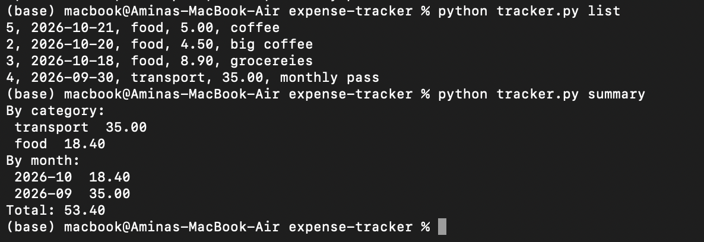

# Expense Tracker


Command-line app that tracks personal spending written in Python and SQLite

## Features

- Add an expense with amount, category, date and details
- List all expenses, newest first
- Summary of spending by category and by month
- Edit or delete an expense by its ID
- Input validation for amounts, dates and empty fields


## Technologies

- Python
- SQLite
- Argparse
- Datetime

## How to run

Requirements: Python 3, with no extra packages to install
```
git clone https://github.com/amina-morsy/expense-tracker.git
cd expense-tracker
python tracker.py
```


## Usage

```
python tracker.py add 12.50 food 2026-10-20 "pizza"
python tracker.py list
python tracker.py summary
python tracker.py edit 1 --amount 15.00
python tracker.py delete 1
```

## Design decisions

- Money is stored as integer cents, to avoid floating-point rounding errors
- Parameterised queries (?) are used to prevent SQL injection
- Input is validated before it reaches the database